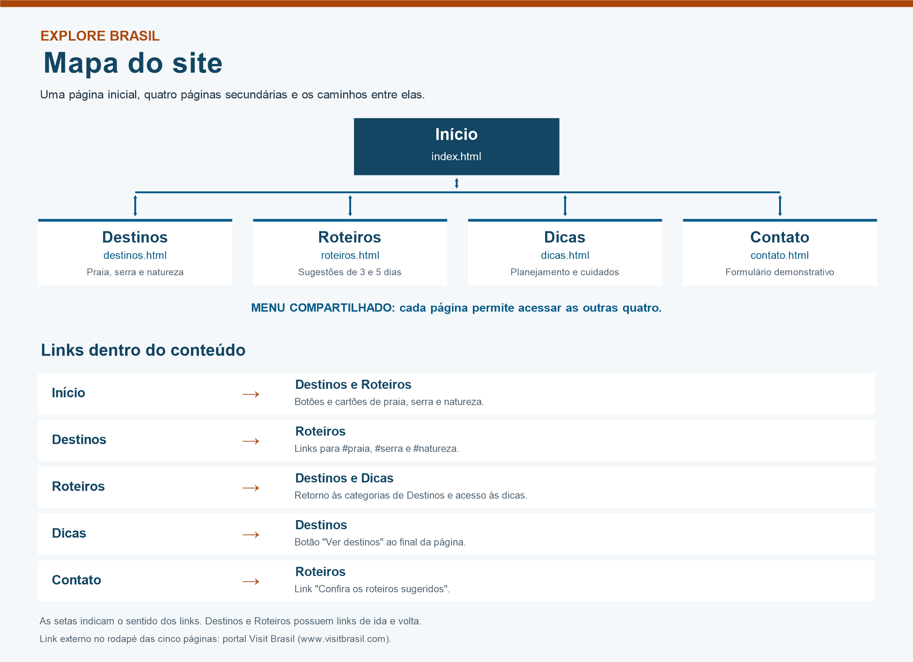

# Explore Brasil

Site acadêmico sobre turismo no Brasil, construído com HTML e CSS. São cinco páginas com menu compartilhado, imagens locais e layout que se adapta à largura da tela.

**Repositório do projeto:** [GabrielRFreitas/Trabalho-site](https://github.com/GabrielRFreitas/Trabalho-site).

## Integrantes

- Gabriel Freitas
- Lucas Rufatto

## Páginas

| Página | Arquivo | Conteúdo |
| --- | --- | --- |
| Início | `index.html` | Apresentação do projeto e estilos de viagem |
| Destinos | `destinos.html` | Seis destinos nas categorias praia, serra e natureza |
| Roteiros | `roteiros.html` | Sugestões de viagens de três e cinco dias |
| Dicas | `dicas.html` | Planejamento, mala, passeios e cuidado com os lugares |
| Contato | `contato.html` | Formulário demonstrativo com validação nativa do HTML |

O site é estático. A página inicial é `index.html`, os estilos estão em `style.css` e as fotografias em `imagens/`. A visualização local pode ser feita abrindo a página inicial no navegador, sem instalação ou banco de dados.

## Estrutura do projeto

```text
Trabalho-site/
├── index.html
├── destinos.html
├── roteiros.html
├── dicas.html
├── contato.html
├── style.css
├── imagens/
│   ├── praia.jpg
│   ├── montanha.jpg
│   └── natureza.jpg
├── documentacao/
│   └── mapa-do-site.png
├── README.md
└── .gitignore
```

## Mapa do site



O menu de cada página permite acessar as outras quatro. O mapa também detalha os links dentro do conteúdo. O rodapé de todas as páginas possui um link externo para o portal Visit Brasil.

## Layout e acessibilidade

O CSS utiliza Flexbox para organizar o cabeçalho, os cartões e o formulário. Em telas de até 700 pixels, os principais conteúdos ficam em uma coluna.

As páginas possuem identificação do idioma, textos alternativos nas imagens, link para pular ao conteúdo, destaque da página atual no menu e indicação visual de foco. Os campos do formulário possuem rótulos associados.

## Formulário de contato

O formulário possui campos obrigatórios para nome, e-mail, destino e mensagem. A validação utiliza os recursos nativos do HTML. Com dados válidos, a página recarrega e abre o aviso explicativo.

O formulário é demonstrativo e não possui processamento de mensagens. Os dados de teste aparecem na URL; o projeto não os armazena nem realiza vendas ou reservas.

## Fotografias

As imagens são ilustrativas dos estilos de viagem e não representam necessariamente os destinos citados. Fontes registradas no projeto:

- [Praia](https://images.unsplash.com/photo-1519046904884-53103b34b206)
- [Montanha](https://images.unsplash.com/photo-1464822759023-fed622ff2c3b)
- [Natureza](https://images.unsplash.com/photo-1441974231531-c6227db76b6e)
